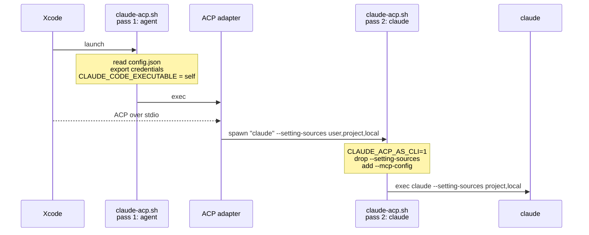

# claude-xcode-agent

Run Claude Code as an Xcode 26 agent, with your own API key or gateway.

Xcode 26 talks to external coding agents over ACP (Agent Client Protocol). Claude Code doesn't speak ACP, so an adapter (`claude-agent-acp`) sits in between. Two things get in the way:

- Xcode launches agents from the GUI, so there is no shell environment to carry a gateway URL or API key.
- The adapter always starts `claude` with `--setting-sources user,project,local`, which pulls in `~/.claude/settings.json` whether you want it or not.

This project fixes both without patching the adapter. A single script, `claude-acp.sh`, is launched twice and plays a different role each time.

## How it works

**Pass 1, as the agent.** Xcode launches `claude-acp.sh`. It reads `config.json`, exports the credentials, points `CLAUDE_CODE_EXECUTABLE` at itself, and `exec`s the adapter. From then on Xcode talks ACP to the adapter directly.

**Pass 2, as claude.** When a session starts, the adapter spawns what it believes is the Claude Code binary. That is `claude-acp.sh` again, now with `CLAUDE_ACP_AS_CLI=1`. It drops the adapter's `--setting-sources`, adds your MCP servers next to the ones Xcode passed, and `exec`s the real `claude`.

Both passes end in `exec`, so no wrapper process is left running and stdout stays a clean ACP channel.

## Setup

    git clone https://github.com/yusuke-114/claude-xcode-agent.git
    cd claude-xcode-agent
    ./setup.sh

`setup.sh` installs Node.js and Claude Code if they're missing, installs the adapter into `.runtime/`, checks it with an ACP `initialize` handshake, and prints the path for Xcode.

To use a gateway or API key, create a config. Without one, `claude` uses its own login.

    cp config.example.json config.json && chmod 600 config.json

Then add the agent in **Xcode › Settings › Intelligence › Add an Agent…**

| Field | Value |
|---|---|
| Name | Claude |
| Executable | the `claude-acp.sh` path printed by setup |
| Interpreter | empty |

If you move this directory, run `./setup.sh` again and update the path in Xcode.

## config.json

| Field | |
|---|---|
| `base_url` | gateway URL, without `/v1/messages` |
| `auth_token` | sent as `Authorization: Bearer` |
| `api_key` | sent as `x-api-key`; use this or `auth_token` |
| `model` | default model |
| `setting_sources` | default `project,local`; set `user,project,local` to also read `~/.claude/settings.json` |
| `mcp_servers` | extra MCP servers, merged with Xcode's |
| `env` | extra environment variables for `claude` |

Effort, permission mode and allowed tools come from Xcode.

Credentials travel as environment variables, and `mcp_servers` is written to `.runtime/mcp.json` (mode 0600), so neither shows up in `ps`.

    "mcp_servers": {
      "my-tool": { "command": "/absolute/path/to/server", "args": ["--stdio"] }
    }

## Debugging

Xcode doesn't show adapter errors anywhere, so they go to `.runtime/agent.log`, along with one line per session.

To capture raw ACP traffic, `touch .runtime/debug`. Messages are written to `.runtime/debug.in.log` and `.runtime/debug.out.log`. These contain your conversation, so delete them when you're done.

## Uninstall

Remove the agent in Xcode, then delete this directory.

## License

[MIT](LICENSE)
