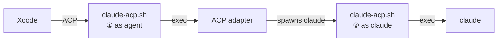

# claude-xcode-agent

Claude Code as an Xcode 26 agent, using your own API key or gateway.

## Design

Xcode talks to agents over ACP, and an adapter (`claude-agent-acp`) bridges ACP to Claude Code. Two problems:

- Xcode starts the agent from the GUI, so there's no shell env to hold a key or gateway URL.
- The adapter hardcodes `claude --setting-sources user,project,local`, so `~/.claude/settings.json` always leaks in.

`claude-acp.sh` fixes both by running twice in two roles:



1. **As agent**: loads `config.json` into env, points `CLAUDE_CODE_EXECUTABLE` at itself, execs the adapter.
2. **As claude**: swaps `--setting-sources` for `project,local`, adds your MCP servers, execs the real `claude`.

Both steps `exec`, so no wrapper process stays alive and stdout stays pure ACP.

## Run

```sh
git clone https://github.com/yusuke-114/claude-xcode-agent.git && cd claude-xcode-agent
./setup.sh        # installs node, claude and the adapter, then prints the path for Xcode

# optional: your own key / gateway / MCP servers
cp config.example.json config.json && chmod 600 config.json
```

In Xcode › Settings › Intelligence › Add an Agent…, set **Executable** to the printed `claude-acp.sh` path.

Logs go to `.runtime/agent.log`.

## License

[MIT](LICENSE)
